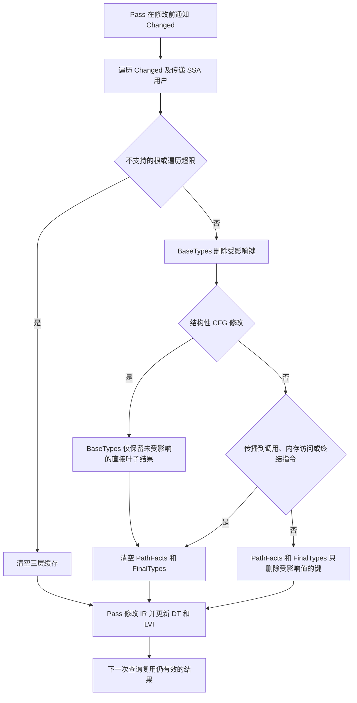

# JavaType 缓存选择性失效设计与实验报告

本次将 `JavaTypeAnalysis` 原有的三层缓存全量清空，改为修改前通知、沿 SSA 使用关系传播、按依赖范围失效。TCE 和 CHA 已接入。在指定 pass 的生成式 IR 实验中，复杂基础表达式复用场景的 `opt` 总耗时中位数相对同一二进制的全量清空模式下降 17.57%，TCE→CHA 场景下降 16.42%；简单叶子类型场景没有测得稳定收益。

最终实验时间为 2026 年 10 月 15 日，开发分支为 `feat/javatype-selective-invalidation`，实现提交为 `14058bf207de68fdfbfa09eaa985dddd9983f340`（主体实现 `34cdbcf19`，LVI 内存访问依赖补强 `14058bf20`）。实验前已有的工作区修改独立保存为 `ab6902023`；本次未修改原始 `IR/Jeandle/JavaType.cpp` 查询算法。本文是新实验报告，原工作报告保留。

## 设计思路

三个缓存的依赖范围不同，适合分层处理：

| 缓存 | 键 | 主要依赖 | 当前处理 |
| --- | --- | --- | --- |
| `BaseTypes` | `Value*` | 属性、元数据、常量对象身份、PHI/select/转发操作数 | 删除受影响值及其传递用户；CFG 变化时进一步删除派生基础类型 |
| `PathFacts` | `(Value*, BasicBlock*)` | CFG、边条件、DT、空边查询 | 普通值修改删除关联键；传播到调用、内存访问或终结指令时全部清理 |
| `FinalTypes` | `(Value*, BasicBlock*)` | 基础类型、路径事实及 PHI incoming | 与路径事实采用同样的保守失效范围 |

失效时遍历修改前的 `Value::users()`，不在每次查询中维护反向依赖图。这样将依赖追踪成本放到修改发生时，也避免 RAUW 之后旧使用关系已经消失。调用、内存访问和终结指令可能改变关于其他值的 guard 或 LVI 事实（包括 load/store 解引用提供的非空信息），因此即使不是查询键，也会触发上下文缓存清理。



结构性 CFG 修改可能改变 PHI 的 incoming 集合，这种依赖不能仅靠终结指令的 SSA 用户覆盖。因此，`CFGChanged=true` 时只保留未受影响的 `Argument`、`CallBase`、`LoadInst` 和 `Constant` 基础结果。它们直接读取属性、元数据或对象身份；这个保留规则以这些信息和 VM 类型关系保持不变为前提。

遍历限制为 4096 个不同值、16384 条 use，超过限制回退到全量清空。Function/global 等不支持的通知根也回退全清。除遍历外，还需扫描相关缓存容器；最坏扫描成本与容器容量有关，当前实现没有声称失效成本只与受影响条目数成正比。

## 实现与调用约束

| 代码位置 | 作用 |
| --- | --- |
| [CachedJavaType.h](../include/llvm/Analysis/Jeandle/CachedJavaType.h) | 三层缓存与 `invalidate(ArrayRef<Value*>, bool)` 契约 |
| [CachedJavaType.cpp](../lib/Analysis/Jeandle/CachedJavaType.cpp) 的 `JavaTypeCache::invalidate` | 使用关系遍历、分层删除、全清回退 |
| [JavaTypeAnalysis.cpp](../lib/Analysis/Jeandle/JavaTypeAnalysis.cpp) 的 `invalidateImpl` | FAM 结果接口、计数与计时、强制全清开关 |
| [TypeCheckElimination.cpp](../lib/Transforms/Jeandle/TypeCheckElimination.cpp) 的 apply 阶段 | 批量修改前通知，清理 LVI，保留已维护的分析 |
| [CHADevirtualization.cpp](../lib/Transforms/Jeandle/CHADevirtualization.cpp) 的调用改写路径 | 区分静态调用替换和 CFG 分裂，删除前通知，更新 DT/LVI |
| [JavaTypeQueryTest.cpp](../unittests/IR/JavaTypeQueryTest.cpp) | 值修改、删除、CFG 与回退等单元测试 |
| [selective-invalidation.ll](../test/Jeandle/java-type-analysis/selective-invalidation.ll) | TCE→CHA 的分析保留及计数回归 |

调用方遵守以下顺序：

```cpp
JavaTypes.invalidate(ChangedValues, /*CFGChanged=*/ChangesCFG);
// 修改操作数、RAUW、删除或改写 CFG。
// 更新 DT，并清理或正确维护 LVI。
JavaTypes.getJavaType(V, Context);
```

删除基本块时，须通知其中所有即将删除的值并声明 CFG 变化；仅通知分支不能覆盖块内的基础缓存键。跨函数、全局属性、VM 类型关系、无法分类的变更仍使用 `clear()`。当前没有通过 ValueHandle 自动监控任意外部修改；不能省略通知，也不能用类型缓存失效代替 DT/LVI 的维护。

TCE 仍先完成全部折叠决策，再批量通知和修改，不改变决策顺序。CHA 的 `_linkToStatic` 替换保留 CFG，因此保留未受影响的派生基础类型；需要插入接收者非空检查或类型检查的路径声明 CFG 修改。两者在维护依赖后显式保留 JavaTypeAnalysis 和 LVI；其他 pass 没有声明保留时，FAM 仍整体丢弃该分析。

本次未改变单次查询的递归状态、预算或结果发布规则。`Processed` 的“有值”表示本次子计算已返回，仍可能受到截断影响；`FactsTruncated` 和 `PhiTruncated` 继续阻止受影响结果进入共享缓存。`PhiCycleHit` 仍可能导致严格相等校验跳过，相关语义验证属于既有后续工作。

## 性能指标

新增指标包括失效请求数、选择性失效数、CFG 失效数、遍历值数、三层分别删除和保留的条目数、总失效时间，并增加进程级总查询时间。原有查询次数、命中统计、基础缓存插入数、校验及跳过次数继续保留。

`base insertions` 表示插入基础缓存的条目次数，用于观察重复计算；不是完整查询的 miss 数。`entries retained` 是各次通知后剩余条目数的累加，同一条目可能被重复计数。`clears` 表示执行全量清空的次数，选择性清理两个上下文缓存不计为一次全清。查询计时包含统计和可选重算校验，正式性能测量关闭 verification。

## 实验方法

环境为 Intel Core i7-14650HX、WSL2 Linux x86_64、LLVM Release 构建，`LLVM_ENABLE_ASSERTIONS=OFF`。基准进程固定到逻辑 CPU 0。机器仍存在调度和频率波动，报告中保留逐次样本与配对 bootstrap 区间。

对比模式如下：

1. **选择性失效**：当前默认实现。
2. **同版本全清**：相同二进制加 `-jeandle-java-type-force-full-invalidation`，每次修改通知都全清，用于隔离失效策略的影响。
3. **原有实现**：修改前保存的 `opt`，源码对应原 HEAD `1e61901b4` 加已有工作区补丁，等价于快照提交 `ab6902023`。它保留原有消费者的清理时机，用于观察完整改动效果。

同版本全清与原有实现的通知次数不同，因此两类对照分别报告。原有实现二进制 SHA256 为 `f3c781f4b7cbe92c87edddda0cba1c5a78f8fc135c35599ec0b26d27bc7a6445`；当前二进制及源码哈希见 [Results.json](JeandleJavaTypeInvalidation/Results.json)。

每组输入包含 64 个函数，每函数 24 个调用点。复杂表达式由 256 层共享 select 链构成；其他对照直接查询参数。四组分别运行 CHA 静态 MethodHandle 解析、TCE→CHA、简单参数上的静态调用解析、以及需要插入 CFG guard 的普通虚调用优化。VM callbacks 使用确定性回放数据，没有人为添加延迟。

计时前检查选择性、全清、旧版、禁用缓存、开启验证五种模式的输出 IR 字节一致，并检查每种模式实际生成 1536 个目标调用。另用 `-verify-each` 验证 IR。正式计时每模式预热 2 次、测量 15 次，每轮随机排列三种计时模式；统计总进程墙钟时间中位数。总耗时包含进程启动、解析、pass 执行和统计输出，IR 输出关闭。verification 单独执行，不参与计时。

这些输入是用于隔离复用行为的生成式 IR，执行的是实际 TCE/CHA pass；未执行完整优化流水线或 JVM 应用。完整流水线可能提前简化 select 链，因此以下收益不能直接外推到真实应用的编译时间或运行时间。

## 实验结果

单位为毫秒；下降比例为 `1 - 选择性耗时 / 对照耗时`，负数表示变慢。

| 场景 | 原有实现 | 同版本全清 | 选择性失效 | 相对同版本全清下降 | 相对原有实现下降 |
| --- | ---: | ---: | ---: | ---: | ---: |
| CHA 静态调用，复杂表达式复用 | 181.026 | 184.638 | 152.197 | 17.57% | 15.92% |
| TCE→CHA，复杂表达式复用 | 181.720 | 183.590 | 153.452 | 16.42% | 15.56% |
| CHA 静态调用，简单叶子类型 | 26.613 | 27.739 | 27.258 | 1.74% | -2.42% |
| CHA 普通虚调用，CFG 改写 | 49.812 | 50.671 | 48.861 | 3.57% | 1.91% |

相对同版本全清的配对 bootstrap 95% 区间依次为 `[14.38%, 19.13%]`、`[14.30%, 20.55%]`、`[-3.17%, 5.14%]`、`[-2.66%, 6.29%]`。简单叶子类型和普通虚调用场景的区间跨零，不能据此判定稳定收益。简单叶子类型相对旧版出现 2.42% 的中位数回退，但区间同样跨零，暂不能判定稳定退化。区间反映本次样本波动，不代表其他硬件或真实应用。

| 场景 | 查询次数 | 全清基础插入数 | 选择性基础插入数 | 插入减少 | 全清查询时间 | 选择性查询时间 | 全清失效时间 | 选择性失效时间 |
| --- | ---: | ---: | ---: | ---: | ---: | ---: | ---: | ---: |
| 复杂静态调用 | 1536 | 396288 | 16512 | 95.83% | 125.287 | 92.763 | 2.023 | 4.117 |
| TCE→CHA | 1600 | 412800 | 16512 | 96.00% | 126.472 | 93.244 | 2.012 | 4.177 |
| 简单叶子类型 | 1536 | 1536 | 64 | 95.83% | 5.872 | 5.613 | 0.457 | 0.634 |
| 普通虚调用 | 1536 | 1536 | 64 | 95.83% | 15.683 | 15.134 | 0.510 | 0.605 |

选择性失效自身有额外遍历和扫描开销。复杂静态调用中，失效时间增加约 2.09 ms，但查询时间减少约 32.52 ms，整体收益成立。简单类型即使显著减少基础缓存插入，省下的计算也很少，不能只凭插入计数判断性能。

本组输入每次调用改写都保守清理上下文缓存，`PathFacts` 和 `FinalTypes` 的命中数均为零。因此，测得收益主要来自保留 `BaseTypes`，不能据此声称已证明细粒度路径事实失效的性能收益。

## 正确性验证

| 验证 | 结果 |
| --- | --- |
| JavaType 单元测试 | 26/26 通过，其中新增 9 项 |
| Jeandle 全目录 lit | 754 项中 730 通过，24 unsupported，无失败 |
| 现有 TCE/CHA 四模式矩阵 | 每模式 29 条 RUN，共 116 条通过，并开启 IR verifier |
| 新增 TCE→CHA 集成测试 | 选择性、全清、验证三条 RUN 全部通过 |
| 四组性能输入正确性 | 五种模式输出 IR 一致，各完成 1536 个调用改写 |
| 性能输入重算校验 | 分别 1536、1600、1536、1536 次，跳过数均为 0 |

新增单元测试覆盖传递用户失效与无关结果保留、RAUW/删除、CFG 删除边与 PHI 重算、guard 非键依赖、强制全清开关、不支持根回退、LVI 依赖失效、遍历超限回退、内存访问非键依赖。原有预算与 PHI 环测试继续通过，但它们仍不能替代所有循环场景的语义正确性证明。

当前验证范围是 LLVM pass 和 callback 回放，未新增 JVM/JDK 端实验。

## 复现操作

在仓库根目录执行。输出目录必须尚不存在，脚本拒绝覆盖已有证据。

```bash
cmake --build build/build-ninja-release \
  --target opt FileCheck JavaTypeQueryTests llc llvm-extract not count split-file \
  --parallel 2

build/build-ninja-release/unittests/IR/JavaTypeQueryTests \
  --gtest_filter='JavaTypeQueryTest.*'

build/build-ninja-release/bin/llvm-lit -sv -j 2 llvm/test/Jeandle

taskset -c 0 python3 llvm/utils/jeandle/benchmark-java-type-invalidation.py \
  --opt build/build-ninja-release/bin/opt \
  --baseline-opt build/build-ninja-release/javatype-invalidation/baseline/opt \
  --out build/build-ninja-release/javatype-invalidation/reproduce \
  --repeats 15 --functions 64 --sites 24 --depth 256 --regress
```

旧版二进制不随 Git 提交分发。没有该本地产物时，可在独立 worktree 构建 `ab6902023` 并将路径传给 `--baseline-opt`；也可省略此参数，仍会完成同一二进制的选择性/全清对照及原始查询、验证检查。

实验脚本为 [benchmark-java-type-invalidation.py](../utils/jeandle/benchmark-java-type-invalidation.py)。提交中保留 [结构化结果与环境](JeandleJavaTypeInvalidation/Results.json) 和 [逐次计时数据](JeandleJavaTypeInvalidation/Samples.csv)，其中 round 为 -2、-1 的行是预热。完整命令、IR、callback 回放、输出及 stderr 位于本地 `build/build-ninja-release/javatype-invalidation/run-20261015-final/`；单元与全目录 lit 记录位于其上级目录的 `unit-final.xml`、`unit-final.log`、`lit-final.json`、`lit-final.log`。

## 下一步

先在真实 JVM 编译轨迹和完整优化流水线上复现，判断复杂基础表达式在实际查询时是否仍存在。随后按失效统计评估缓存扫描开销和小方法退化，再决定是否引入反向依赖索引或更细的上下文失效。只有需要保留更多 PHI/路径结果时，才扩大依赖模型，避免以查询精度或正确性换取命中率。

查询状态方面，优先区分预算耗尽与不可约 CFG 环的诊断计数，补足 PHI 环中不同查询顺序的明确类型期望。`FactsTruncated` 的查询级粘性策略偏保守，可以进一步研究子问题完成状态；递归栈和预算仍应保持单次查询语义。
